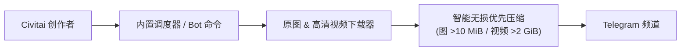

<div align="center">

<picture>
  <source media="(prefers-color-scheme: dark)" srcset="assets/logo-dark.svg">
  <source media="(prefers-color-scheme: light)" srcset="assets/logo-light.svg">
  
</picture>

# civitai-monitor

**在 Telegram 里自动追更 Civitai 创作者——自动抓最高清原图与原视频，超限智能压缩不丢消息，1 GB 小内存机器也能稳稳跑。**


[快速开始](#quick-start) · [核心特性](#highlights) · [Bot 命令](#bot-commands) · [进阶配置](#more-details)

[English](README.md) · **简体中文**

</div>



<a id="highlights"></a>

## 核心特性

| | |
|---|---|
| 📸 **无损原图 + 真高清视频** | 自动重写 URL 拉取最高清原图与 Backblaze B2 上的真高清视频——不是封面缩略图。 |
| 🤖 **Bot 按钮分页管理** | 订阅 / 取消 / 回填 / 手动扫描 / 调间隔，全部通过分页交互按钮完成；每个 Telegram 用户的订阅列表互相隔离。 |
| 🗜 **智能压缩不丢帖** | 图片超过 10 MiB、视频超过 2 GiB 时自动走无损优先压缩梯队并兜底——消息一定能送到频道。 |
| 🪶 **1 GB 小内存友好** | 内存由 systemd（如 `MemoryMax`）静态约束，流式/轻量处理，OOM 断点续接回填，`fcntl` 文件锁防重推。 |

<a id="quick-start"></a>

## 快速开始

### 1. 安装

```bash
git clone https://github.com/dorokuma/civitai-monitor.git
cd civitai-monitor
python3 -m venv .venv
.venv/bin/pip install -r requirements.txt
# 视频压缩需要 PATH 上有 ffmpeg/ffprobe，例如：
sudo apt-get install -y ffmpeg
```

### 2. 配置 `.env`

```bash
cp config.yaml.example config.yaml

mkdir -p ~/.civitai-monitor
cat > ~/.civitai-monitor/.env <<'ENV'   # load_env.py 会自动加载
CIVITAI_BOT_TOKEN=<你的-bot-token>
ENV
chmod 600 ~/.civitai-monitor/.env

# 编辑 config.yaml → 填入 chat_id、authorized_users、subscriptions
```

最小 `config.yaml`：

```yaml
telegram:
  chat_id: "<你的-telegram-chat-id>"

authorized_users:
  - <你的-telegram-user-id>

subscriptions:
  '<你的-telegram-user-id>':
    - name: "<目标-civitai-用户名>"
```

> [!NOTE]
> `subscriptions` 以 **Telegram 用户 ID** 为 key，不是 Civitai 用户名。
> 在 Telegram 上给 @userinfobot 发消息即可查到数字用户 ID。

### 3. 启动 Bot 与内置调度器

```bash
.venv/bin/python3 civitai-bot.py
```

> [!NOTE]
> Bot 的**内置调度器**已取代旧的 cron 方案——按可配置的间隔（默认 10 分钟，
> 用 `/interval` 调整）自动运行 `monitor.py` 增量扫描。无需再配置 crontab。

<a id="bot-commands"></a>

## Bot 命令

| 命令 | 作用 |
|------|------|
| `/add <用户名\|链接\|@名>` | 添加监控——支持纯用户名、`@名`、`civitai.com/user/…` 链接，添加前自动验证用户存在 |
| `/remove` | 分页按钮列表，点选取消关注 |
| `/list` | 查看你的订阅列表 |
| `/status` | 运行状态：磁盘、已处理数、配置 |
| `/scan` | 立即执行一次增量扫描 |
| `/backfill` | 分页按钮列表，回填某创作者全部历史 |
| `/interval <分钟>` | 设置扫描间隔（默认 10，范围 1–1440） |
| `/mode <incremental\|full>` | 切换扫描模式（全局生效） |
| `/nsfw <sfw_only\|nsfw_only\|both>` | 切换 NSFW 过滤（全局生效） |
| `/cleanup [天数]` | 清理 N 天前的缓存文件 |
| `/stop` | 终止当前定时扫描并释放 `.monitor.lock`（方便立即开始回填等操作） |
| `/help` | 显示全部命令 |

每个授权 Telegram 用户只能看到和管理**自己**的订阅；
推送目标始终是配置里唯一的 `telegram.chat_id` 频道。

## 最低硬件要求

| 项目 | 要求 |
|------|------|
| **内存（最低）** | 1 GB——全量回填峰值接近 1.7 GB，1 GB 能跑但需留意 OOM |
| **内存（推荐）** | 2 GB 及以上 |
| **内存约束** | 进程内不设内存上限——需要时用 systemd（如 `MemoryMax`）静态约束；小内存运行依赖流式/轻量处理 |
| **磁盘** | 取决于订阅量与缓存策略（`keep_days` + `max_total_gb`），建议预留 10 GB 以上 |
| **Python** | 3.10+ |
| **外部工具** | 视频压缩需要 `ffmpeg`/`ffprobe` |

> [!TIP]
> 全量回填被 OOM 杀掉并不可怕——断点续接机制会自动从被杀的位置继续。

<a id="more-details"></a>

## 进阶配置与部署

<details>
<summary><b>完整环境变量参考</b></summary>

| 变量 | 必填 | 说明 |
|------|------|------|
| `CIVITAI_BOT_TOKEN` | ✅ | Telegram Bot Token。优先于 `config.yaml`——`write_config` 保存 yaml 时会剥离 `bot_token`。 |
| `telegram.chat_id`（yaml） | ✅ | 接收推送的频道/群组/私聊 ID。全部订阅者共用这一个推送目标。 |
| `authorized_users`（yaml） | ✅ | 允许给 Bot 下命令的 Telegram 用户 ID。 |
| `subscriptions`（yaml） | ✅ | 按 Telegram 用户隔离的订阅列表，以 TG 用户 ID 为 key。 |
| `mode`（yaml） | | `incremental`（默认）或 `full` 全量回填。 |
| `nsfw`（yaml） | | `sfw_only` / `nsfw_only` / `both`（默认）。 |
| `video_enabled` / `max_video_size_mb`（yaml） | | 开关视频下载；跳过大于 N MiB 的视频（默认 1024）。 |
| `compress`（yaml） | | 超限媒体的无损优先压缩梯队（默认开启；关闭后超限媒体降级为文本提示）。 |
| `http.cookies_file`（yaml） | 仅视频 | 从已登录 Civitai 的浏览器导出的 Netscape 格式 cookies.txt——真视频下载必需。 |
| `download.keep_days` / `download.max_total_gb`（yaml） | | 缓存保留：删 N 天前的文件，或总大小超上限（默认 10 GB）时删最旧的。 |
| `data.data_dir`（yaml） | | 各用户 `seen_ids/` 进度 JSON 的存放目录（留空 = 仓库目录）。 |
| `incremental.*` / `reconciliation.*`（yaml） | | 分页窗口与每日 03:30 对账扫描调优——见 `config.yaml.example`。 |
| `interval.json` | | `/interval` 写入的运行时扫描间隔（`{"seconds": 600}`）。 |

完整带注释的 schema 见 [`config.yaml.example`](config.yaml.example)。
`.env` 默认从 `~/.civitai-monitor/.env` 自动加载（见 `load_env.py`）。

**视频 cookies：** CDN 要登录态才返回真视频文件。用浏览器扩展（如 *Get cookies.txt*）
导出 `cookies.txt`，把 `http.cookies_file` 指过去即可；cookies 过期后重新导出。
没有它，视频只会拿到封面图或退化为文本链接。

</details>

<details>
<summary><b>systemd 部署与通用备份建议</b></summary>

以 `<install-dir>` 为例安装（如 `/opt/civitai-monitor`），用 `<your-user>` 运行：

```ini
# /etc/systemd/system/civitai-bot.service
[Unit]
Description=Civitai Monitor Bot
After=network.target

[Service]
Type=simple
User=<your-user>
WorkingDirectory=<install-dir>
ExecStart=<install-dir>/.venv/bin/python3 <install-dir>/civitai-bot.py
Restart=always
RestartSec=10

[Install]
WantedBy=multi-user.target
```

```bash
sudo systemctl daemon-reload
sudo systemctl enable --now civitai-bot
```

> [!WARNING]
> **单实例约束。** 互斥依赖本地 `fcntl` 文件锁（`.monitor.lock`），
> 只能在**单台主机上以单实例**运行。多主机或多实例部署会让锁失效，
> 导致重复下载与重复推送。

**通用备份建议：** 按你自己的备份计划保管以下小文件即可：

- `<install-dir>/config.yaml`、`<install-dir>/interval.json`、`<install-dir>/active_backfills.json`
- `<install-dir>/seen_ids/` —— 各用户下载进度
- `~/.civitai-monitor/.env` 与 `civitai_cookies.txt` —— 仓库外的密钥文件

可跳过：`downloads/`（可重下的缓存）、`.venv/`（用 `requirements.lock` 重建）、
`.git/` 与工具缓存。恢复时把文件拷回、重建 venv、装依赖、修属主、重启服务即可。

</details>

<details>
<summary><b>目录结构与本地测试</b></summary>

```
civitai-monitor/
├── monitor.py                  # 扫描器 CLI 入口与向后兼容门面
├── civitai-bot.py              # 管理 Bot CLI 入口、内置调度器与门面
├── civitai_monitor/            # 拆分后的扫描、媒体下载、Bot 状态/调度/指令核心包
├── bot_ui.py                   # Bot UI 辅助
├── civitai_client.py           # Civitai API 客户端
├── state_store.py              # 各用户 seen_ids / pushed_ids 状态
├── telegram_media.py           # Telegram 上传 / 压缩流水线
├── media_compress.py           # 无损优先压缩梯队
├── config_io.py                # config.yaml 读写
├── load_env.py                 # .env 加载器
├── backfill-memory-wrapper.py  # 回填启动包装脚本（os.execv 透传 monitor.py）
├── config.yaml.example         # 带注释的配置模板
├── requirements.txt / requirements.lock
├── assets/                     # Logo（暗色 & 亮色）
├── tests/                      # pytest 测试
└── .github/workflows/          # CI（lint + 测试）

# 运行时文件（已被 git 忽略）：
#   config.yaml · interval.json · active_backfills.json
#   civitai_cookies.txt · seen_ids/ · downloads/ · monitor.log*
```

本地测试：

```bash
python3 -m venv .venv
.venv/bin/pip install -r requirements.txt pytest
.venv/bin/python -m pytest tests/
```

</details>

## 免责声明

> 仅供**学习与个人使用**。下载的媒体版权归创作者所有；请遵守 Civitai
> [服务条款](https://civitai.com/terms-of-service)与各作品的授权协议。
> 未经创作者明确许可，请勿再分发下载内容。

## 许可证

[MIT](LICENSE) © dorokuma
